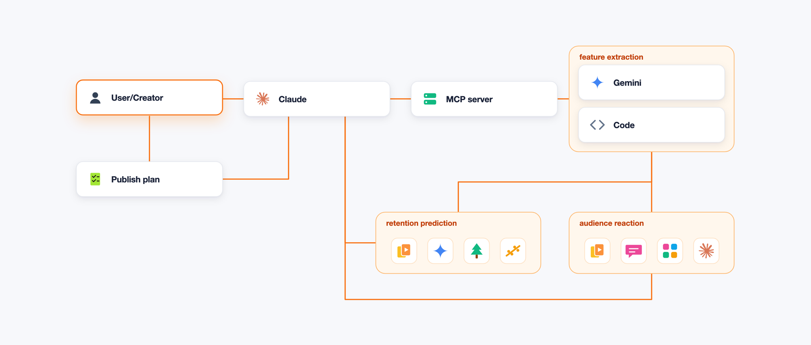

# YouTube Short Copilot

Ask a chatbot whether people will watch your Short to the end, before you post it. (for brawl stars specific content)

You give Claude a draft YouTube Short. Claude calls this project's tools and writes a publish plan: how the
opening, middle and ending are expected to hold viewers, where they are most likely to leave, what to change,
and how the audience is likely to react.

<!-- demo video here -->



I built and use this for my own Brawl Stars channel ([@alfie369k](https://www.youtube.com/@alfie369k/shorts)).

Channel stats:
- 46.7M views
- 393.6K watch time hours
- 37.7K subscribers
- 1.8M likes

## How it works


1. **Connect.** The project runs as an MCP server; in Claude it is added once as a custom connector.
2. **Upload.** Claude hands out a one-time upload link, because chatbots do not pass video files to tools.
3. **Extract features.** Gemini watches the draft and writes a second-by-second description plus a fixed
   checklist of structure features. Code measures cuts, first and last frame, and length.
4. **Predict retention.** Each part of the curve goes to the method that was built off of or inspired by research:
   - an LLM judge (Gemini, reading the description) for where viewers leave and the middle of the video;
   - a random forest for the opening and the ending;
   - a ridge regression over the video, moment by moment, for the shape of the curve.
5. **Audience reaction.** How viewers are likely to respond is built from two sources of evidence:
   - the real comments on the most similar past Shorts, grouped by theme;
   - a web search by Claude on the draft's topics, for what the Brawl Stars community is saying right now.
6. **Answer.** Claude writes the publish plan. Every fix and idea in it has to come from a tool result.

## The models used and why

- **Gemini, for feature extraction.** It takes video and audio directly, so it can write the second-by-second
  description and fill in a fixed checklist of structure features that everything else works from.
- **LLM-as-a-judge (Gemini), for the middle and the drop-off points.** Gemini reads the text description, not
  the video, and estimates where viewers leave. This is inspired by [*Large Language Models Are Natural Video Popularity
  Predictors*](https://aclanthology.org/2025.findings-acl.597/) (Kayal et al., ACL Findings 2025), which found that a language model can predict how a video
  performs once the video has been turned into text.
- **Random forest, for the opening and the ending.** These depend on structure: how late the main payoff comes
  and how much video is left after it. The effects have thresholds (a long tail after the payoff hurts, a short
  one does not), which trees capture. With about 150 training videos the model has to stay small, so it uses
  nine features (sample-size guidance from Riley et al., [*Statistics in Medicine*, 2019](https://onlinelibrary.wiley.com/doi/10.1002/sim.7993)).
- **Ridge regression, for the shape of the curve.** It goes through the video moment by moment and predicts how
  many of the remaining viewers leave at each one. Put together, those predictions form the retention curve.
  Every moment of every past Short is a training example, so a few hundred videos become tens of thousands of
  examples. The idea comes from [*Multimodal Metric Learning for Fine-Grained Video Retention Prediction in
  Ego-Centric Networks*](https://doi.org/10.15407/jai2026.01.127) (2026), which models retention on a single creator's channel in the same way.
- **Sentence embeddings (`all-mpnet-base-v2`), for similar Shorts.** Descriptions are compared by cosine
  similarity to retrieve the closest past Shorts with their real retention and comments, as evidence.

## Why not just predict views?

Views depend mostly on distribution, not on the video: on this channel the median Short has about 13,000 and
the largest 10.6 million. Retention is decided by the video itself and can be checked against real curves, so
that is what the tool predicts, and only relative to the channel's own past Shorts.

This follows [*Delving Deep into Engagement Prediction of Short Videos*](https://doi.org/10.1007/978-3-031-72949-2_17) (Li et al., ECCV 2024; 90,000 Snapchat
videos), which argues against view count and raw watch time as targets and uses watch percentage adjusted for
video length. The targets here apply the same idea to the opening, middle and ending separately.

What I tried before this: asking Gemini to judge the video directly (it scored at chance), one model for overall
retention (the score mixes too many things, so nothing beat the average), gradient boosting (no better than the
forest on this little data) and TabPFN (too small a gain to be worth it, and its licence rules out
production use). More in [RESULTS.md](RESULTS.md).

## Evaluation

Every prediction was tested on videos the system had never seen, with the pass rule written down before the test
set was opened. Method, numbers and what failed: [RESULTS.md](RESULTS.md).

## Tools (MCP)

| Tool | Returns |
|---|---|
| `start_draft` | a draft id and a one-time upload link |
| `get_draft_status` | where the analysis is |
| `get_retention` | verdicts for opening, middle and ending with reasons, drop moments, advice |
| `get_similar_shorts` | the closest past Shorts with real retention and top comments |
| `get_audience_brief` | the draft's description, real comments by theme, and research instructions |

## Running it

```
pip install -r requirements.txt
python -m src.server.auth create --label me            # prints an access token once
SO_PUBLIC_BASE_URL=https://your-address python -m src.server.app
python -m pytest tests/
```

Needs ffmpeg and a Gemini API key (`GEMINI_API_KEY_PAID`). The server needs the channel's exported data and
fitted library under `data/`, which is not in the repository. Uploads are limited to 8-60 seconds, checked
before any paid call, and deleted after analysis; access is by per-user token with daily limits and spend caps.

## Layout

- `src/channel_export/`: OAuth export of the channel's own data
- `src/tools/analyze_video/`: Gemini extraction prompt, schema, code-measured features
- `src/models/`: training, cross-validation, the held-out protocol
- `src/tools/predict_retention/`, `src/tools/audience/`: the tools' logic
- `src/server/`: MCP server, upload page, auth, quotas
- `docs/architecture.html`: the interactive diagram

It is trained on my channel only. If you want to run it on your own channel's data, I can see it working without
changing much: export your channel, re-run the feature extraction and refit the models. I have not tested that.
